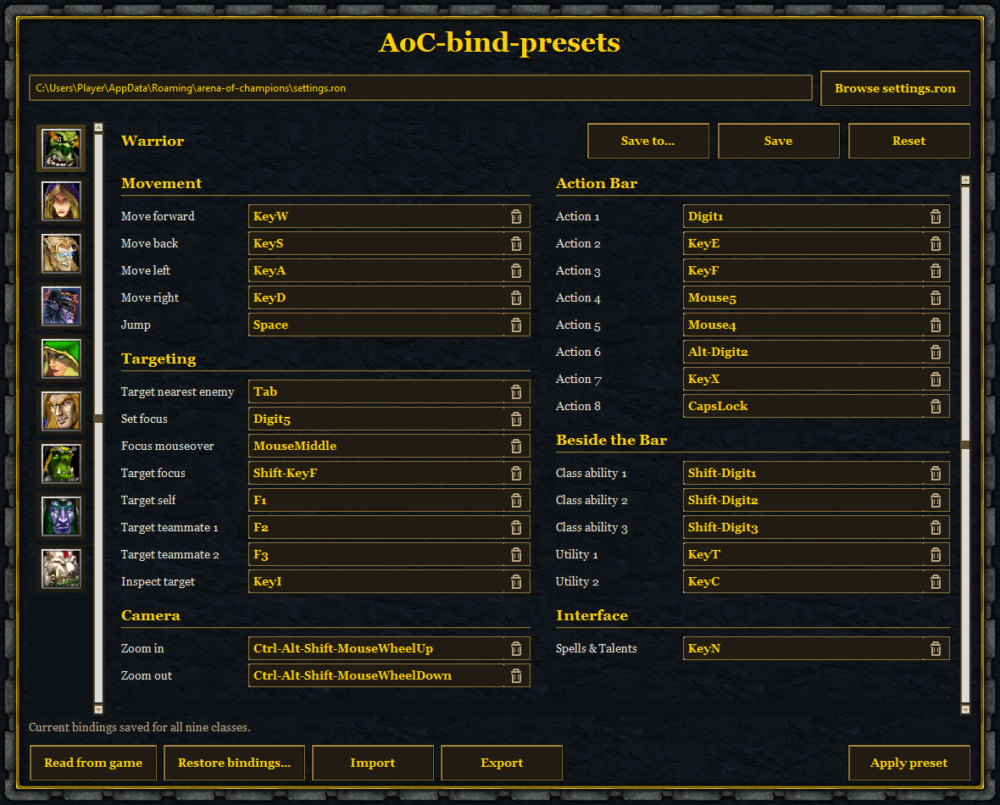

# AoC-bind-presets

keybinding preset manager for Arena of Champions



Save a preset for each specialization and switch between them whenever you need. Each class has three specialization buttons with WoW Classic icons. 

On the first launch, the app reads your saved game bindings and copies them to every specialization. A backup of your original settings.ron will be saved into ```data\original-settings.ron```.

## How to use

1. Select a class, then a specialization.
2. Click a binding and press a key or mouse button. Use the trash icon to clear it.
3. Click **Save**, then **Apply preset**.

If the game is open, you can accept or cancel its restart. Assigning a binding already in use swaps the two actions. The previous action is highlighted in yellow for three seconds. Conflicts in imported presets still turn red. Use **Restore bindings** to recover a backup.

## Download

Download the `.exe` from the [latest release](https://github.com/gallardoS/aoc-bind-presets/releases/latest) and open it. No installation needed.

The app checks for updates when opened. If a newer release is available, an update window shows the download progress and stays open until the updated app has opened. Your presets and any bindings you were editing are kept. If you are offline, you can keep using the app.

For Windows. Sign in to Arena of Champions at least once before using the app. Applying presets requires an internet connection.

Your presets are saved in the `data` folder next to the app. Keep that folder when moving or updating the app.

## Build it yourself

On Windows, install **Python 3.13** with **Tcl/Tk support**. Open a terminal in this repository and run:

```powershell
py -3.13 -m venv .venv
.venv\Scripts\python.exe -m pip install -r requirements-build.txt
.venv\Scripts\python.exe -m PyInstaller aoc-bind-presets.spec
```

The executable will be in `dist\AoC-bind-presets.exe`.

To run the tests:

```powershell
.venv\Scripts\python.exe -m unittest discover -s tests
```

## Automatic releases

Every push to `main` runs the tests, builds the app, and publishes a new release with the `.exe`. Versions are numbered automatically: `v1.0.0`, `v1.0.1`, and so on.

You can also start the **Release** workflow manually from **Actions**. If a check fails, no release is published.
